# Post-contenido — Unidad 9: Seguridad en Aplicaciones Web

## Descripción
Repositorio del laboratorio de la Unidad 9 de Programación Web —
Séptimo Semestre. Contiene un único proyecto Maven Spring Boot
(seguridad-web/) con dos mecanismos de autenticación coexistiendo:
sesión (Spring Security form-login) para las vistas Thymeleaf, y
JWT stateless para la API REST bajo /api/**.

Dominio: `Usuario` (rol ADMIN o USER) y `Tarea` (cada usuario crea
las suyas). Paquete raíz `com.universidad.seguridad`, organizado en
`config`, `controller`, `service`, `repository`, `model` y `security`.

## Parte 1 — Login con Sesión, BCrypt, Roles y Mitigación Activa
SecurityConfig define webFilterChain (@Order(2), securityMatcher
"/**") con form-login, BCryptPasswordEncoder (fuerza 12) y
autorización por rol: `/admin/**` solo para ADMIN con HttpSecurity,
y además `@PreAuthorize` en los servicios (`listarTodos()` solo ADMIN,
`listarDe(id)` solo ADMIN o el dueño de las tareas).
Se demuestra activamente la mitigación de XSS contrastando th:text
(seguro) con th:utext (inseguro) sobre el mismo campo, y la de SQL
Injection contrastando @Query parametrizado con una consulta
concatenada documentada solo en comentario.

### Pruebas realizadas
- **BCrypt:** al registrar usuarios, MySQL guarda solo el hash
  (`$2a$12$...`), nunca la contraseña en texto claro.
- **Roles:** con un usuario USER, `/admin` responde 403; con
  `admin@universidad.edu` el panel muestra la lista de usuarios.
- **XSS:** se registró un usuario con nombre
  `<script>alert("XSS")</script>`. Con `th:text` (versión que queda en
  el repositorio) el dashboard muestra el texto literal. Cambiando
  temporalmente esa línea a `th:utext`, el navegador ejecuta el script
  y aparece la alerta. El cambio se revirtió y no está en ningún commit.
- **SQL Injection:** en el buscador de tareas se escribió
  `' OR '1'='1` y la búsqueda devuelve 0 resultados, porque
  `@Query` con `:texto` envía el valor como parámetro del
  PreparedStatement y se trata como texto literal. Con la versión
  concatenada (comentada en `TareaRepository`) la consulta habría
  quedado `... LIKE '%' OR '1'='1%'`: la condición siempre verdadera
  habría devuelto todas las tareas de todos los usuarios, sin filtrar.
- **CSRF:** un `POST /logout` sin token (con curl) responde 403
  Forbidden. El botón "Cerrar Sesión" del dashboard sí funciona porque
  Thymeleaf agrega el token CSRF al formulario y redirige a
  `/login?logout`.

## Parte 2 — API REST Stateless Protegida con JWT
SecurityConfig agrega apiFilterChain (@Order(1), securityMatcher
"/api/**"), stateless (SessionCreationPolicy.STATELESS), con CSRF
desactivado SOLO en esta cadena porque no depende de cookies.
JwtUtil genera y valida el token (firma HMAC + expiración de 1
hora); JwtAuthFilter (OncePerRequestFilter) lo valida en cada
petición a /api/** y puebla el SecurityContext manualmente, sin
consultar la base de datos en cada request.

Endpoints:
- `POST /api/auth/login` — recibe `{"email","contrasenia"}` y devuelve
  `{"token","email","rol"}`. Con credenciales incorrectas responde 401
  sin emitir token.
- `GET /api/tareas` — tareas del usuario dueño del token.

### Pruebas realizadas
- Login con credenciales válidas: devuelve el token.
- `GET /api/tareas` con `Authorization: Bearer <token>`: 200.
- Sin header Authorization: 401.
- Con un token inventado o con los últimos caracteres de la firma
  cambiados: 401. Detalle curioso: cambiar solo el último carácter de
  la firma a veces NO invalida el token, porque en Base64URL ese
  carácter lleva bits de relleno que no forman parte de los 32 bytes
  de la firma HMAC; por eso se cambiaron varios caracteres.
- Token expirado: se levantó una segunda instancia en el puerto 8081
  con `--app.jwt.expiracion-ms=3000`; el token funciona al instante y
  4 segundos después la misma petición responde 401.
- Mientras se hacían estas pruebas con curl, la sesión del navegador
  en `/dashboard` siguió funcionando sin cerrar sesión ni reiniciar.

## Por qué dos mecanismos en el mismo proyecto
Las vistas Thymeleaf sirven a un navegador con cookie de sesión: CSRF
debe seguir activo ahí. La API sirve a clientes sin cookies (app
móvil, SPA externa, integración de terceros): un token autocontenido
en el header Authorization resuelve ese caso sin depender de estado
en el servidor. Ningún mecanismo reemplaza al otro; cada uno cubre
un tipo de cliente distinto del mismo sistema.

## Decisiones de diseño
1. Dominio pequeño (Usuario y Tarea): la unidad evalúa la capa de
   seguridad, no el modelado; con dos entidades la evidencia de las
   pruebas no se diluye entre muchas pantallas.
2. securityMatcher explícito y @Order en las dos cadenas: Spring
   Security usa la primera cadena cuyo matcher coincide. Sin @Order(1)
   en la de `/api/**`, una petición a la API podría caer en el
   form-login y responder con una redirección en vez de 401.
3. JwtAuthFilter no lanza excepciones: si el token falta o es inválido
   solo deja de autenticar, y la decisión de rechazar queda centralizada
   en `authorizeHttpRequests` de apiFilterChain.
4. CSRF desactivado solo en apiFilterChain: la API no usa cookie de
   sesión, y un formulario cross-site no puede fijar el header
   Authorization. En webFilterChain CSRF sigue activo sin excepción.

### Ajustes que hubo que hacer frente al código de la guía
- `UsuarioPrincipal` (extiende `User` y guarda el `id`): la regla
  `#usuarioId == authentication.principal.id` de TareaService no se
  puede evaluar con el `User` de Spring, que no tiene id. Por eso
  UserDetailsService devuelve `UsuarioPrincipal`, y el JWT lleva el id
  en el claim `uid` para que JwtAuthFilter arme el mismo principal sin
  ir a la base de datos.
- El dashboard muestra el **nombre** buscado en la BD, no
  `auth.getName()`: `getName()` es el correo, que tiene validación
  `@Email` y no admite el payload de XSS; el nombre es el campo libre
  donde el ataque puede llegar a la vista.
- `HttpStatusEntryPoint(401)` en apiFilterChain: sin formLogin ni
  httpBasic, Spring Security responde 403 por defecto a una petición
  sin autenticar, y la guía pide 401.
- Bean `AuthenticationManager`: en Spring Security 6 no se expone
  automáticamente y ApiAuthController lo necesita.
- `FilterRegistrationBean` deshabilitado para JwtAuthFilter: al ser
  `@Component`, Spring Boot lo registraría también como filtro global
  y correría en las peticiones de las vistas con sesión.
- `GET /api/tareas` devuelve un record `TareaResponse` en vez de la
  entidad, para no exponer en el JSON el hash de la contraseña del
  propietario.
- Buscador de tareas (`/tareas/buscar`) y vista "Mis tareas": la guía
  pide probar el buscador, así que se agregó la vista que lo usa.

## Nota de seguridad para producción
La clave HMAC ya no está escrita en JwtUtil: se lee de
`app.jwt.secret` en application.properties, que toma la variable de
entorno `JWT_SECRET` si existe. El valor por defecto
(`clave-secreta-minimo-32-caracteres-laboratorio`) existe solo para que
el laboratorio arranque sin configurar nada. En un proyecto real debe
definirse `JWT_SECRET` (o usarse un gestor de secretos) y no dejar
ningún valor utilizable en el repositorio: cualquiera con acceso al
código fuente podría firmar tokens válidos si la clave queda expuesta.

## Cómo compilar y ejecutar
1. Clonar el repositorio: `git clone https://github.com/DanielUsopp/Mena-post1-U9.git`
2. Crear la base de datos seguridad_db en MySQL:
   ```sql
   CREATE DATABASE seguridad_db CHARACTER SET utf8mb4 COLLATE utf8mb4_unicode_ci;
   CREATE USER 'appuser'@'localhost' IDENTIFIED BY 'apppass';
   GRANT ALL PRIVILEGES ON seguridad_db.* TO 'appuser'@'localhost';
   ```
3. Configurar seguridad-web/src/main/resources/application.properties
   con las credenciales de MySQL (o las variables `DB_USER` y
   `DB_PASSWORD`)
4. Ejecutar `./mvnw spring-boot:run` dentro de seguridad-web/ (las
   tablas se crean con `ddl-auto=update`)
5. Insertar un usuario ROLE_ADMIN siguiendo la Parte 1, Paso 8 (el
   hash de `admin123` se genera con el `PasswordEncoder` del proyecto)
6. Vistas web: http://localhost:8080/login
7. API: POST http://localhost:8080/api/auth/login

Las pruebas (`./mvnw test`) usan H2 en memoria, así que no necesitan
MySQL encendido.

## Capturas de pantalla
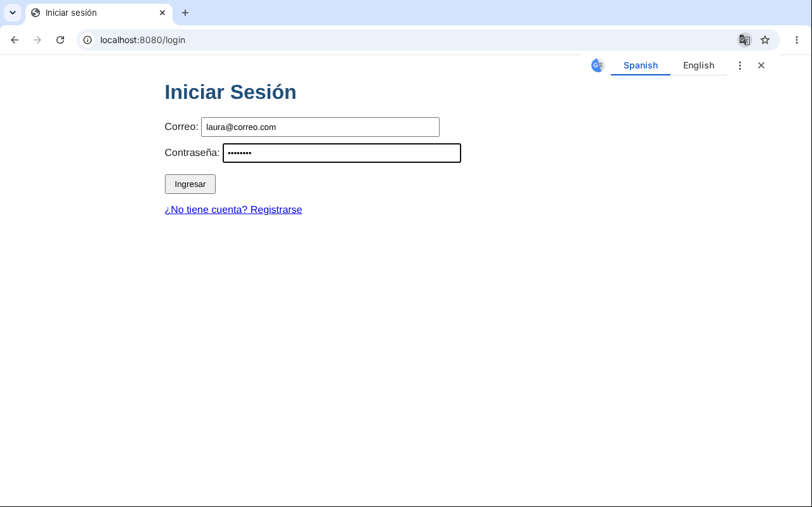
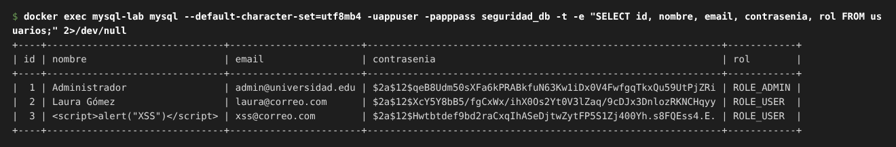
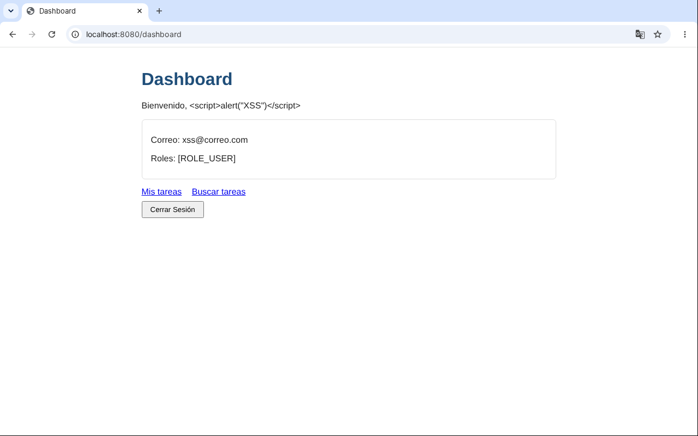
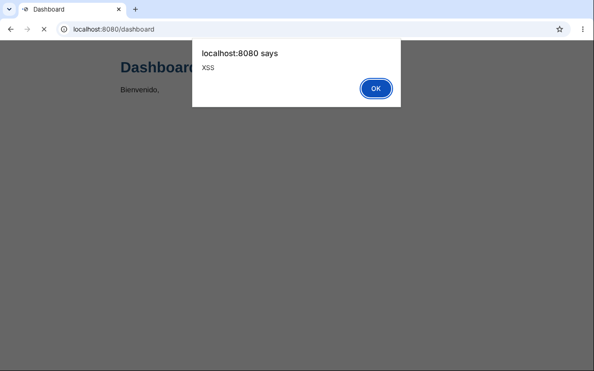
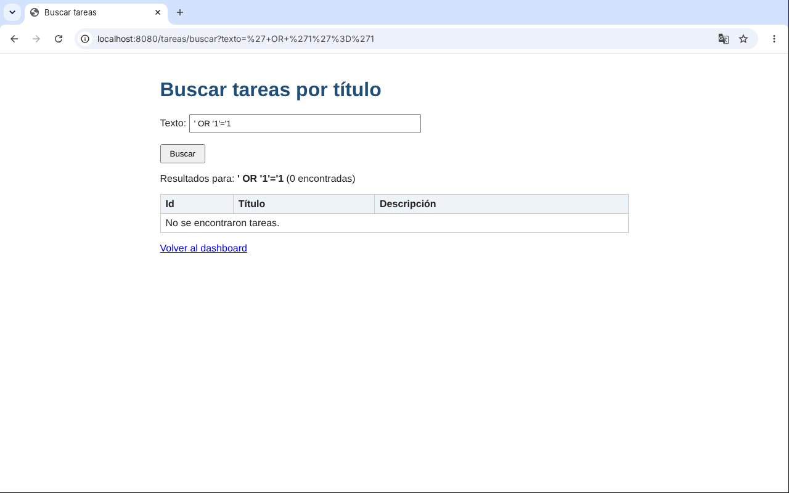
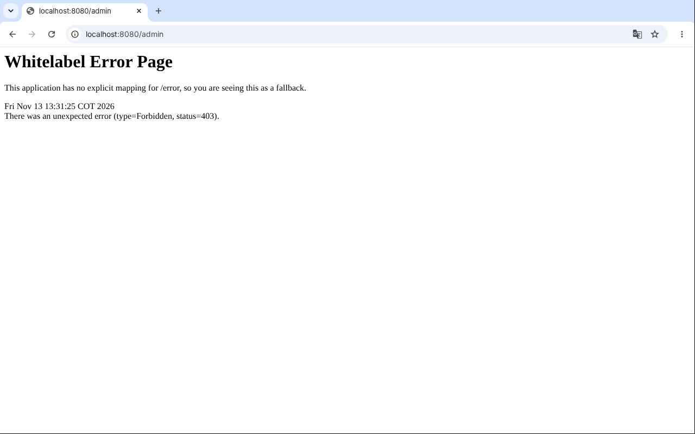
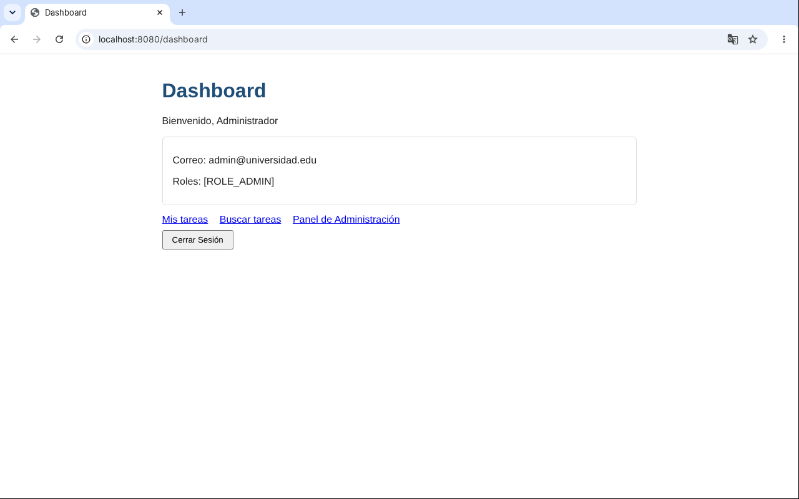
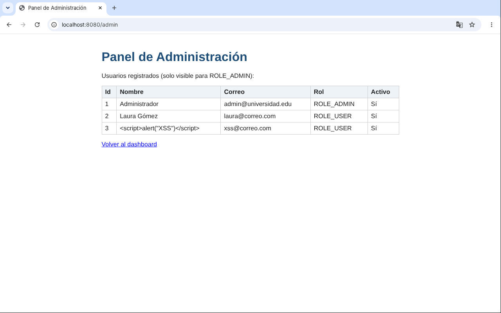
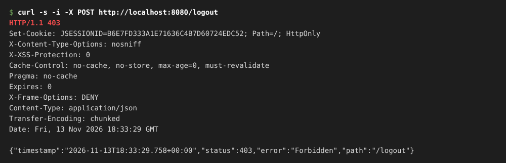
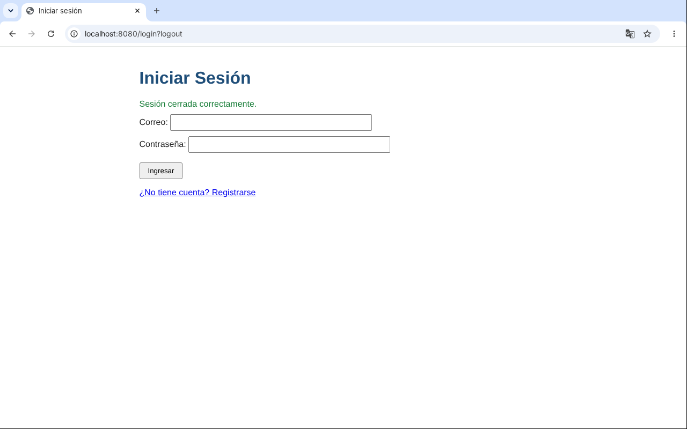
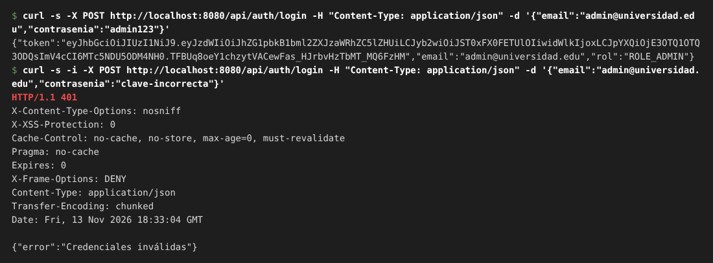
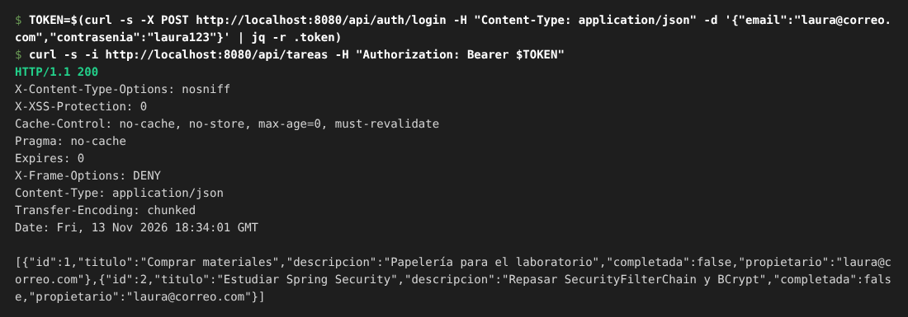
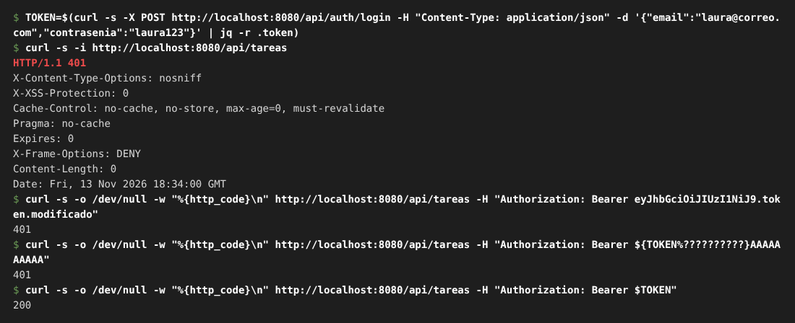
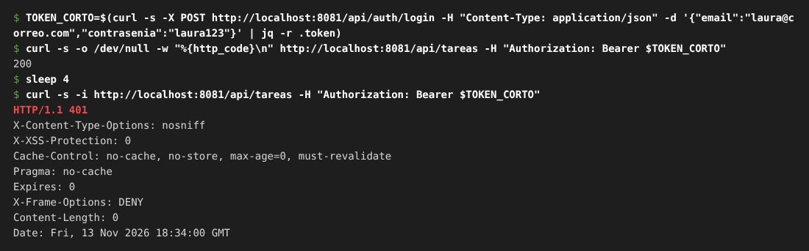
